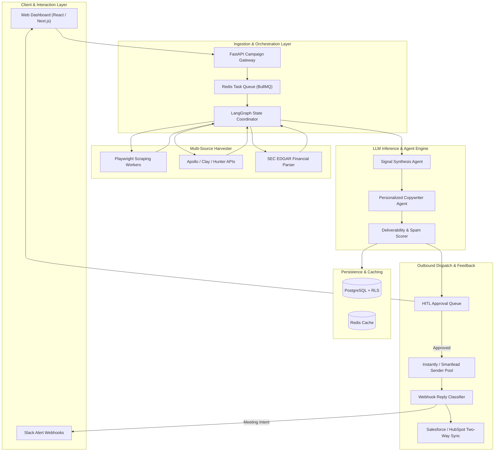
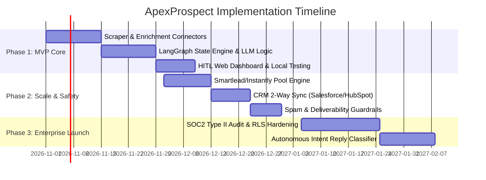
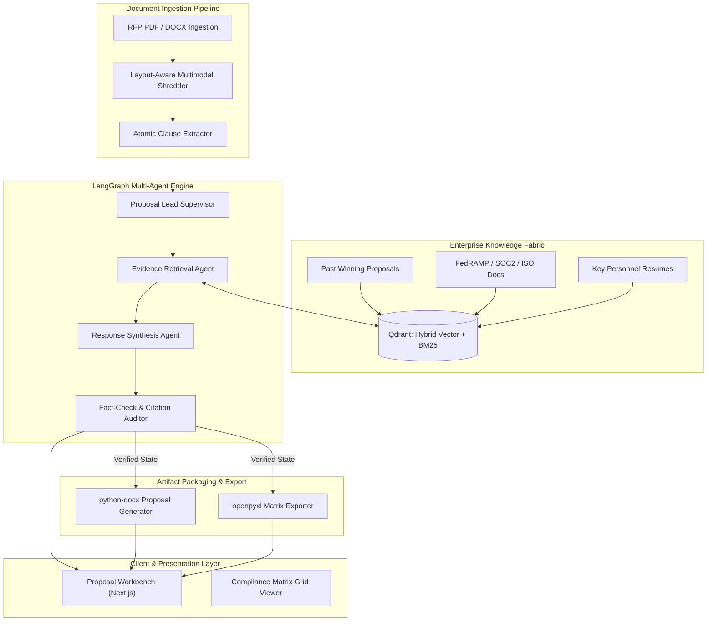
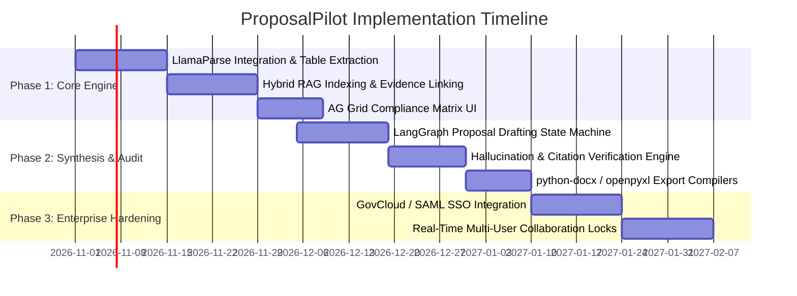
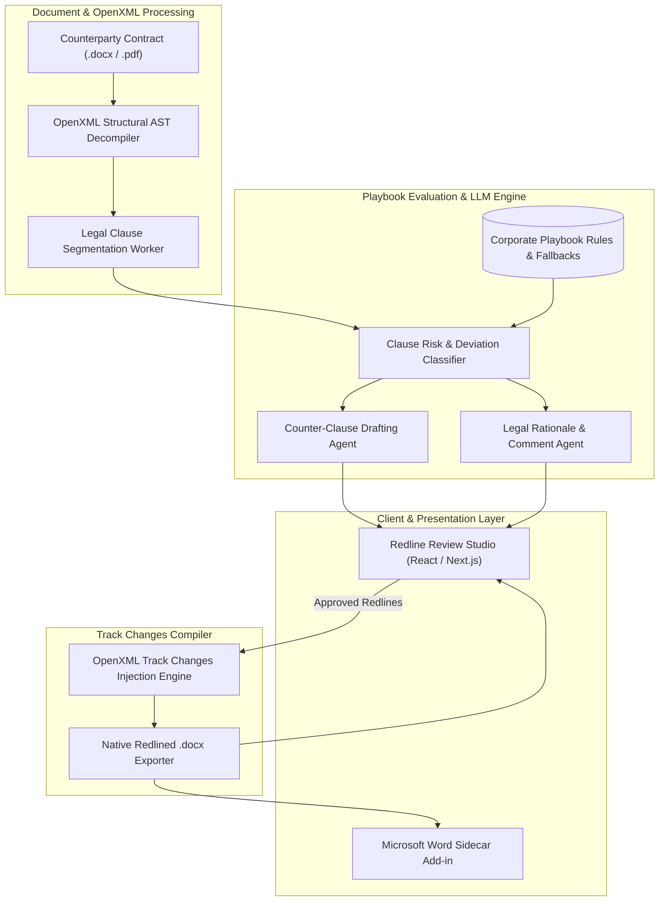
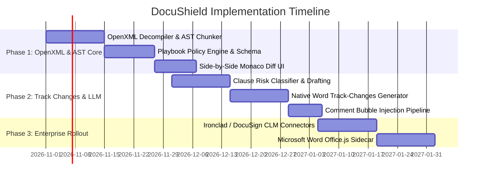

# Autonomous AI Agent Systems: Architecture, UI/UX Design, and Use Case Specifications

> **Document Type**: Enterprise Software Architecture & Product Design Specification  
> **Author**: Senior Software Architect & Principal UX Designer  
> **Status**: Approved Production Specification  
> **Version**: 2.4.0  
> **Scope**: Three Commercial-Grade, Monetizable Autonomous AI Agent Systems  

---

## Document Index
1. [Idea 1: Autonomous B2B SDR Agent (`ApexProspect`)](#idea-1-autonomous-b2b-sdr-agent-apexprospect)
   - 1.1 Overview & Assumptions
   - 1.2 High-Level Architecture Plan
   - 1.3 High-Level UI Design & Wireframes
   - 1.4 Line-by-Line Use Case Execution
   - 1.5 Next Steps & Implementation Roadmap
2. [Idea 2: Autonomous RFP & Government Tender Closer (`ProposalPilot`)](#idea-2-autonomous-rfp--government-tender-closer-proposalpilot)
   - 2.1 Overview & Assumptions
   - 2.2 High-Level Architecture Plan
   - 2.3 High-Level UI Design & Wireframes
   - 2.4 Line-by-Line Use Case Execution
   - 2.5 Next Steps & Implementation Roadmap
3. [Idea 3: Enterprise Contract Redliner & Legal Risk Guard (`DocuShield`)](#idea-3-enterprise-contract-redliner--legal-risk-guard-docushield)
   - 3.1 Overview & Assumptions
   - 3.2 High-Level Architecture Plan
   - 3.3 High-Level UI Design & Wireframes
   - 3.4 Line-by-Line Use Case Execution
   - 3.5 Next Steps & Implementation Roadmap
4. [Cross-System Synthesis & Strategic Next Steps](#4-cross-system-synthesis--strategic-next-steps)

---

# Idea 1: Autonomous B2B SDR Agent (`ApexProspect`)

## 1.1 Overview & Assumptions

### 1.1.1 Concept Summary
`ApexProspect` is an autonomous outbound sales agent platform designed to replace repetitive prospecting, background research, and manual cold outreach. Unlike legacy sequencer tools that blast static email templates, `ApexProspect` operates as an autonomous agent fleet: discovering accounts matching an Ideal Customer Profile (ICP), scraping 10-K financial filings, monitoring job postings for technical debt triggers, deducing executive pain points, crafting hyper-personalized multi-touch pitches, and booking meetings directly into sales reps' calendars.

### 1.1.2 Business Model & Monetization
* **SaaS Subscription Tier**: $799/month base platform fee (includes 1,000 deep-researched accounts/month).
* **Performance-Based Upsell**: $100 per qualified, attended calendar booking.
* **Target Enterprise Savings**: Replaces 2–3 entry-level SDR headcount seats ($140,000–$210,000/year fully loaded cost savings).

### 1.1.3 Explicit Architectural Assumptions
1. Target prospects and organizations possess identifiable digital footprints (LinkedIn company pages, corporate careers portals, SEC EDGAR filings, GitHub activity, or industry press releases).
2. Cold email delivery utilizes an external pool of warmed secondary domains with rotating mailboxes (via Instantly or Smartlead) to protect the customer's primary corporate domain reputation.
3. Outbound emails require Human-in-the-Loop (HITL) batch review by default during initial client onboarding (first 30 days), transitioning to automated dispatch once user-adjusted confidence thresholds exceed 92%.
4. Contact validation is performed synchronously via enterprise email verification providers (ZeroBounce / NeverBounce) prior to drafting.

---

## 1.2 High-Level Architecture Plan

### 1.2.1 Core Components and Responsibilities

| Component Name | Architectural Responsibility |
| :--- | :--- |
| **ICP & Campaign Ingestion Gateway** | Ingests ICP criteria (firmographics, funding stage, hiring roles, keywords) via REST API and seeds prospect queues. |
| **Autonomous Signal Harvester** | Orchestrates containerized headless browser workers (Playwright) and enrichment APIs to extract unstructured signals. |
| **Signal Synthesis & Pain Matrix Engine** | LLM-powered analyzer that correlates public signals (e.g., job openings for Snowflake engineers) with client value propositions. |
| **Hyper-Personalized Copywriter Agent** | Generates non-templated, contextual email pitches with tailored subject lines, contextual hooks, and frictionless calls to action (CTAs). |
| **Deliverability & Spam Auditor** | Runs heuristic and NLP checks against spam trigger words, reading grade levels, link density, and mobile viewport word counts. |
| **HITL Approval Gate & Checkpointer** | Freezes execution state into persistent storage; presents diff views for sales managers; resumes state upon approval. |
| **Dispatch & Reply Intelligence Worker** | Manages rate-limited sending across warmed SMTP inboxes, parses inbound replies, and categorizes intent (Interested, Objection, Unsubscribe). |

### 1.2.2 System Diagram



### 1.2.3 Data Flow Between Components
1. **Ingress**: User configures ICP filters in the Web Dashboard; API writes the campaign definition to PostgreSQL and enqueues discovery tasks in Redis.
2. **Extraction**: The State Coordinator spins up Playwright workers and queries enrichment APIs to collect executive dossiers, tech stack tags, and recent news.
3. **Synthesis**: Raw telemetry is routed to the Signal Synthesis Agent (Claude 3.5 Haiku / Gemini 2.0 Flash) to identify primary business friction points.
4. **Drafting**: The Copywriter Agent (Claude 3.5 Sonnet) receives the synthesized friction point, client solution pitch, and writes a concise 3-sentence email.
5. **Validation**: The Deliverability Scorer checks spam score, tone, and readability. If score $\ge 90$, draft routes to the pending queue.
6. **Review / Dispatch**: If HITL is active, the sales rep reviews the draft in the UI. Upon approval, the Dispatch Worker sends via rotated SMTP mailboxes.
7. **Feedback**: Inbound replies hit webhook endpoints, are classified by the Reply Parser, and high-intent leads are synced directly into Salesforce or HubSpot.

### 1.2.4 Recommended Tech Stack

| Tier | Technology | Justification |
| :--- | :--- | :--- |
| **Frontend** | Next.js 15, React 19, Tailwind CSS, shadcn/ui | Server-side rendering for speed; high-density dashboard components; native streaming support. |
| **Backend API** | Python 3.12, FastAPI, AsyncIO | High-throughput async I/O; first-class ecosystem for AI agent orchestration and tool execution. |
| **Agent Framework** | LangGraph, Pydantic | Deterministic state-machine graphs, built-in state checkpointing, and cyclic execution with HITL gates. |
| **Database & Cache** | PostgreSQL (Supabase), Redis | Relational integrity for billing and contacts; Redis for distributed sub-millisecond task queuing. |
| **Inference Gateway** | LiteLLM, Claude 3.5 Sonnet, Gemini 2.0 Flash | Cost-tiered model routing: Flash for high-volume signal extraction; Sonnet for creative, human-grade copy. |
| **Observability** | LangSmith, OpenTelemetry | Real-time trace visualization, token cost attribution per prospect, and prompt regression tracking. |

### 1.2.5 Key Integrations & External Services
* **Enrichment Services**: Apollo.io, Clay, LinkedIn Sales Navigator API.
* **Scraping Infrastructure**: Browserbase / Bright Data residential proxy pool.
* **Email Infrastructure**: Smartlead.ai / Instantly.ai REST APIs with webhook listeners.
* **Enterprise CRMs**: Salesforce REST API, HubSpot OAuth2 App.
* **Calendar Sync**: Cal.com / Calendly API for automatic meeting attribution.

---

## 1.3 High-Level UI Design & Wireframes

### 1.3.1 Main Screens and Purpose
1. **Campaign & ICP Studio**: Define target accounts, buyer titles, value propositions, and trigger thresholds.
2. **Prospecting Stream & Live Agent Canvas**: Real-time observability dashboard showing active worker status, scraped signals, and reasoning tokens.
3. **Outbound Review & HITL Queue**: Split-pane interface allowing 1-click approvals, inline edits, and tone adjustments for pending emails.
4. **Deal Pipeline & Reply Tracker**: Kanban-style board tracking sent emails, delivered pitches, positive replies, and booked discovery calls.

### 1.3.2 Screen Layout Descriptions

#### Screen: Outbound Review & HITL Queue (`/campaigns/:id/review`)
* **Header Area**: Campaign title breadcrumb, active sending mailbox health indicator (Green/99.4%), total pending drafts badge, and "Approve All Verified (14)" master action button.
* **Left Navigation**: Compact vertical icon bar (Dashboard, Campaigns, HITL Inbox [Count: 14], Knowledge Base, Settings).
* **Main Content Area (Split View)**:
  * *Left Column (Dossier View)*: Prospect details (Name, Title, Company, Headcount, Series B funding), extracted trigger signals (e.g., "Hiring 6 Data Engineers"), and source citation pills with clickable links.
  * *Right Column (Drafting & Quality View)*: Editable email preview, subject line variant dropdown, deliverability score badge (e.g., 96/100), spam scan breakdown, and word count gauge.
* **Footer / Action Bar**: Sticky bottom bar with "Regenerate Angle", "Reject/Skip", and "Approve & Schedule Send" buttons with keyboard shortcut indicators (`[Cmd+Enter]`).

### 1.3.3 ASCII Wireframe: Outbound Review & HITL Queue

```text
+----------------------------------------------------------------------------------------------------+
|  APEXPROSPECT OS  |  Campaigns > FinTech Scale-ups Q4  |  Mailbox Health: 99.2%  |  [User: Alex M.]|
+----------------------------------------------------------------------------------------------------+
| [D] Dashboard | PENDING DRAFTS (14)                     | TOTAL APPROVED TODAY: 42                 |
| [C] Campaigns +-----------------------------------------+------------------------------------------+
| [*] HITL (14) | PROSPECT DOSSIER & EXTRACTED SIGNALS    | AGENT-GENERATED DRAFT REVIEW             |
| [K] Knowledge |-----------------------------------------+------------------------------------------|
| [S] Settings  | Sarah Jenkins                           | Subject: Quick question on Snowflake lag |
|               | VP of Engineering @ FinEdge ($45M B)    |------------------------------------------|
|               | Location: Austin, TX | 185 Employees    | Hi Sarah,                                |
|               |                                         |                                          |
|               | EXTRACTED BUYING SIGNALS:               | Noticed FinEdge recently opened 6 Data   |
|               | [!] Signal 1: Hiring 6 Data Engineers   | Engineer roles in Austin - congrats on   |
|               |     Source: LinkedIn Careers (2d ago)   | the expansion!                           |
|               | [!] Signal 2: Postgres + Snowflake      |                                          |
|               |     Source: GitHub tech stack tags      | Usually when scaling transaction volume  |
|               |                                         | at your trajectory, teams spend 30%+ of  |
|               | VALUE PROPOSITION MATCH:                | sprint cycles resolving schema drift     |
|               | AutoSync Engine eliminates manual ETL   | and replication delays.                  |
|               | maintenance for financial ledgers.      |                                          |
|               |                                         | We built an autonomous pipeline that     |
|               | DELIVERABILITY CHECKS:                  | syncs Postgres to Snowflake sub-second   |
|               | [✓] Spam Score: 0.2/10.0 (Safe)         | with zero ETL overhead for Brex & Ramp.  |
|               | [✓] Reading Level: Grade 6.4            |                                          |
|               | [✓] Word Count: 88 words                | Open to a 10-min teardown this Thursday  |
|               |                                         | at 2pm CT to see if this saves your      |
|               |                                         | data team ~15 hours a week?              |
|               |                                         |                                          |
|               |                                         | Best,                                    |
|               |                                         | Alex Miller | Sales Engineering          |
|               +-----------------------------------------+------------------------------------------+
|               | [ < Previous ]    [ Reject / Skip ]     | [ ↻ Regenerate ]  [ ✓ APPROVE (Cmd+↵) ]  |
+---------------+-----------------------------------------+------------------------------------------+
```

---

## 1.4 Line-by-Line Use Case Execution

### 1.4.1 Actors & Preconditions
* **Primary Actor**: Business Development Representative (BDR) / Growth Lead.
* **Secondary Actor**: Outbound Lead Prospect (Executive Target).
* **Preconditions**:
  1. User has connected authenticated sending domains with SPF/DKIM/DMARC configured.
  2. ICP parameters (Titles: "VP Engineering", "CTO"; Industry: "FinTech"; Location: "US") are defined.
  3. Knowledge Base contains the company's product one-sheeter and customer case studies.

### 1.4.2 Step-by-Step Main Flow

```text
Line 01: User triggers the campaign execution by selecting "Launch Autonomous Prospecting" in the Campaign Studio.
Line 02: Ingestion Gateway validates campaign quotas against user subscription limits and initializes a new execution run.
Line 03: State Coordinator queries Apollo/Clay APIs to fetch 25 verified executive profiles matching the ICP criteria.
Line 04: Contact Validation Worker verifies MX records and email mailbox existence via ZeroBounce; discards invalid emails.
Line 05: Autonomous Signal Harvester launches headless browser workers to scrape recent LinkedIn postings and company news.
Line 06: Harvester extracts hiring announcements, tech stack mentions, and quarterly business priorities for each account.
Line 07: Signal Synthesis Agent compares extracted findings with product solution capabilities stored in the Knowledge Base.
Line 08: Synthesis Agent selects the single highest-leverage friction point (e.g., data pipeline latency due to team expansion).
Line 09: Copywriter Agent drafts a personalized subject line and 3-sentence body tailored to the prospect's exact role and context.
Line 10: Deliverability & Spam Auditor inspects the draft for spam triggers, excessive punctuation, and mobile readability.
Line 11: Auditor assigns a quality score of 96/100 and persists the completed execution payload to PostgreSQL.
Line 12: System places the draft into the HITL Approval Queue and emits a real-time notification to the Web UI via WebSockets.
Line 13: User opens the Outbound Review Queue and inspects the prospect's extracted signals alongside the generated draft.
Line 14: User presses `Cmd+Enter` to approve the email draft without modifications.
Line 15: State Coordinator transitions mission status from `WAITING_APPROVAL` to `SCHEDULED_SEND`.
Line 16: Dispatch Engine selects an active, warm secondary mailbox and transmits the message via the Smartlead sending pool.
Line 17: Dispatch Engine logs the outbound timestamp and creates a corresponding lead record with activity history in Salesforce.
Line 18: System transitions the prospect state to `LISTENING_FOR_REPLY` and initializes a 3-day follow-up watchdog timer.
```

### 1.4.3 Alternative and Exception Flows
* **Alt Flow 1: Low Confidence Signal (< 80/100)**: If the Signal Harvester finds insufficient recent data on a prospect, the system skips cold outreach, logs `INSUFFICIENT_SIGNALS` in the audit ledger, and automatically advances to the next candidate account in the queue.
* **Exception Flow 1: Mailbox Rate Limit / Bounce Detection**: If the secondary sending mailbox encounters an SMTP 421 rate limit or hard bounce, the Dispatch Engine instantly pauses the affected mailbox, redistributes remaining outbound tasks across healthy pool mailboxes, and flags the contact record as unverified.
* **Exception Flow 2: Inbound Out-of-Office / Unsubscribe**: The Reply Intelligence Worker parses inbound replies using NLP sentiment classification; if an unsubscribe request is identified, it permanently adds the prospect to the global exclusion suppression list across all campaigns and updates Salesforce.

### 1.4.4 Expected Outcome
The target executive receives a timely, relevant, non-spam email grounded in real business triggers. The sales rep eliminates 4 hours of manual research per day, while maintaining full supervisory governance.

---

## 1.5 Next Steps & Implementation Roadmap



---

# Idea 2: Autonomous RFP & Government Tender Closer (`ProposalPilot`)

## 2.1 Overview & Assumptions

### 2.1.1 Concept Summary
`ProposalPilot` is an autonomous enterprise proposal response platform that ingests 50–200 page commercial Requests for Proposals (RFPs), Department of Defense/Federal tenders, and vendor security questionnaires. It decomposes unstructured solicitations into an exhaustive compliance matrix, cross-references internal corporate data vaults (SOC2 audits, FedRAMP accreditations, past winning bids, and engineering whitepapers) using Hybrid RAG, synthesizes certified response drafts, and flags compliance gaps with cryptographic citation verification.

### 2.1.2 Business Model & Monetization
* **SaaS Enterprise Retainer**: $3,500 – $9,500/month per organization (tiered by active proposal seats and document volume).
* **Value Proposition**: Cuts proposal generation time from 60+ human hours to under 4 hours; increases bid submission volume by 400% without increasing headcount.

### 2.1.3 Explicit Architectural Assumptions
1. Input RFPs are supplied as unstructured, complex PDFs, DOCX files, or multi-tab Excel workbooks containing nested requirement tables.
2. The enterprise client possesses an authoritative knowledge base of past performance, architecture whitepapers, certified resumes, and compliance attestations.
3. Every factual assertion drafted by the agent must provide an immutable, traceable citation linking directly to a specific source document and paragraph ID in the knowledge repository (Zero Hallucination Tolerance).
4. Export deliverables must produce Microsoft Word (`.docx`) and Excel (`.xlsx`) formats matching standard federal/enterprise formatting specifications.

---

## 2.2 High-Level Architecture Plan

### 2.2.1 Core Components and Responsibilities

| Component Name | Architectural Responsibility |
| :--- | :--- |
| **Multimodal Document Shredder** | Layout-aware document parsing engine (Unstructured / LlamaParse) that extracts tables, headers, and numbered clause trees. |
| **Requirements Decomposition Engine** | Deconstructs RFP text into an atomic, structured compliance matrix (`Section_ID`, `Mandatory_Flag`, `Requirement_Summary`). |
| **Hybrid Vector & Lexical RAG Vault** | Enterprise vector database (Qdrant/pgvector) pairing dense semantic search with sparse BM25 indexing for acronyms and cert IDs. |
| **Bid Compliance Synthesizer** | Multi-agent drafting pipeline synthesizing persuasive, compliant prose directly answering each requirement. |
| **Fact-Checking & Citation Auditor** | Validates every assertion against retrieved context; computes citation grounding scores ($0.0 - 1.0$); flags unsupported claims. |
| **Federal / Enterprise Document Packager**| Assembles validated proposal responses into polished `.docx` proposals and `.xlsx` compliance matrices with custom branding. |

### 2.2.2 System Diagram



### 2.2.3 Data Flow Between Components
1. **Intake**: User uploads an 84-page RFP PDF via the Web UI.
2. **Decomposition**: The Multimodal Shredder parses document geometry; the Atomic Clause Extractor isolates individual solicitation requirements (e.g., "Sec 3.1.2: Mandatory FedRAMP High Authorization").
3. **Retrieval**: For each requirement, the Evidence Retrieval Agent queries the Hybrid Index using dense vectors and BM25 keywords (e.g., searching for "FedRAMP High", package IDs, and authorization boundaries).
4. **Drafting**: The Response Synthesis Agent drafts a tailored response, referencing explicit package numbers and architectural controls.
5. **Audit**: The Fact-Check Auditor reviews the draft against the retrieved context. If any assertion lacks documentation proof, the status is flagged as `COMPLIANCE_GAP_REQUIRES_INPUT`.
6. **Delivery**: The user reviews the compliance matrix in the Web UI, resolves any highlighted gaps, and exports a fully formatted 38-page `.docx` proposal.

### 2.2.4 Recommended Tech Stack

| Tier | Technology | Justification |
| :--- | :--- | :--- |
| **Frontend** | React 19, AG Grid Enterprise, Tailwind CSS | AG Grid delivers enterprise spreadsheet capabilities for large multi-hundred-row compliance matrices. |
| **Backend API** | Python 3.12, FastAPI, Celery / Redis | Robust asynchronous processing for heavy PDF chunking and multi-agent drafting workloads. |
| **Vector DB** | Qdrant / PostgreSQL pgvector | Native hybrid search (dense embeddings + sparse BM25 vectors) ensures exact token retrieval for compliance codes. |
| **Parsing Engine** | LlamaParse / Unstructured.io | Preserves complex table geometry, merged cells, and nested section hierarchies across multi-page government documents. |
| **LLM Inference** | Claude 3.5 Sonnet (200k context) & GPT-4o | Extended context windows to hold multiple past performance case studies and complex requirement sets simultaneously. |
| **Document Export**| `python-docx`, `openpyxl` | Headless, pixel-perfect programmatic generation of styled Word and Excel deliverables. |

### 2.2.5 Key Integrations & External Services
* **Storage**: Amazon S3 / Google Cloud Storage with AES-256 server-side encryption.
* **Authentication**: SAML 2.0 / Okta SSO for enterprise defense and aerospace contracting compliance.
* **Government Portals**: SAM.gov and GovTribe webhook listeners for automated tender ingestion.

---

## 2.3 High-Level UI Design & Wireframes

### 2.3.1 Main Screens and Purpose
1. **Tender Ingestion & Status Dashboard**: Upload RFPs, monitor parsing progress, view submission deadlines and win probabilities.
2. **Interactive Compliance Matrix**: High-density grid mapping RFP sections, compliance status (`MET`, `PARTIALLY_MET`, `EXCEPTION`), and draft answers.
3. **Draft Synthesis Studio & Citation Inspector**: Document-style reading view showing drafted proposal sections with interactive inline evidence pills.
4. **Knowledge Vault Manager**: Enterprise repository management for audit packages, security policies, and team credentials.

### 2.3.2 Screen Layout Descriptions

#### Screen: Interactive Compliance Matrix (`/rfp/:id/matrix`)
* **Header Area**: Solicitation identifier (`RFP-2026-USAF-CLOUD-908`), submission countdown timer ("Due: 8 Days"), compliance score gauge ("100% Compliant"), and "Export Deliverables" dropdown.
* **Filter Bar**: Status filters (`All`, `Met [30]`, `Needs Review [2]`, `Gaps [0]`), search by section ID, and keyword filter.
* **Main Content Area (Data Grid)**: Multi-column spreadsheet layout displaying Section ID, Government Requirement Text, Compliance Status Badge, Synthesized Response Preview, and Evidence Source Tag.
* **Right Drawer (Inspector Pane)**: Displays extracted source citations, confidence scores, and raw knowledge base chunks supporting the selected row.

### 2.3.3 ASCII Wireframe: Interactive Compliance Matrix

```text
+----------------------------------------------------------------------------------------------------+
|  PROPOSALPILOT AI  |  Tender: RFP-2026-USAF-CLOUD-908 (US Air Force)  |  Due: 8 Days  | [Export v] |
+----------------------------------------------------------------------------------------------------+
| [=] Tenders  | COMPLIANCE STATUS: [ 100% MET (32/32) ]  |  WIN PROBABILITY SCORE: 88%              |
| [X] Matrix   +-------------------------------------------------------------------------------------+
| [D] Document | Filter: [ All Sections ]  [ Search Requirements... ]      | Showing 32 Requirements |
| [V] Vault    +---------+------------------------------+------------+-------------------------------+
|              | SEC ID  | SOLICITATION REQUIREMENT     | STATUS     | SYNTHESIZED RESPONSE & SOURCE |
|              +---------+------------------------------+------------+-------------------------------+
|              | 3.1.2   | Mandatory FedRAMP High       | [ MET ]    | "Vendor maintains active DoD  |
|              |         | Authorization on all hosting |            | IL5 & FedRAMP High Package ID |
|              |         | environments prior to award. |            | #FR-2024-8839 with reciprocal |
|              |         |                              |            | ATO on AWS GovCloud..."       |
|              |         |                              |            | Evidence: [Doc #C-04 (p.12)]  |
|              +---------+------------------------------+------------+-------------------------------+
|              | 4.4.0   | Sub-minute automated multi-  | [ MET ]    | "System leverages multi-region|
|              |         | region disaster failover     |            | active-active architecture    |
|              |         | with RPO < 5 seconds.        |            | with automated Route53 health |
|              |         |                              |            | checks achieving 4s RPO..."   |
|              |         |                              |            | Evidence: [Whitepaper_Arch.pdf|
|              +---------+------------------------------+------------+-------------------------------+
|              | 5.2.1   | Key Personnel: Minimum 5 SREs| [ MET ]    | "Allocated 6 named SREs with  |
|              |         | holding active TS/SCI status.|            | current TS/SCI clearances..." |
|              |         |                              |            | Evidence: [Staffing_Plan.xlsx]|
+--------------+---------+------------------------------+------------+-------------------------------+
| SELECTED ROW EVIDENCE INSPECTOR (Section 3.1.2)                                                    |
| Grounding Confidence: 99.4% | Matched Chunk: FedRAMP_High_Certification_2025.pdf (Page 12, Para 4)   |
| "FedRAMP Joint Authorization Board (JAB) granted High Baseline ATO under ID FR-2024-8839..."       |
| [ Edit Synthesized Answer ]   [ Replace Citation Source ]   [ Flag for Security Officer Review ]   |
+----------------------------------------------------------------------------------------------------+
```

---

## 2.4 Line-by-Line Use Case Execution

### 2.4.1 Actors & Preconditions
* **Primary Actor**: Senior Proposal Manager / Bid Director.
* **Secondary Actor**: Solutions Architect / Compliance Officer.
* **Preconditions**:
  1. User has uploaded verified corporate assets into the Knowledge Vault.
  2. Inbound RFP document (`RFP-2026-USAF-CLOUD-908.pdf`, 84 pages) is available.

### 2.4.2 Step-by-Step Main Flow

```text
Line 01: Proposal Manager uploads the 84-page RFP PDF through the Tender Ingestion interface.
Line 02: Document Ingestion Pipeline queues background parsing tasks in Celery and calculates SHA-256 document checksum.
Line 03: Multimodal Shredder processes PDF page geometry, extracting 32 distinct requirement clauses across Sections 3, 4, and 5.
Line 04: Requirements Decomposition Engine structures clauses into an atomic tabular schema and persists them to PostgreSQL.
Line 05: Proposal Lead Supervisor initializes a parallel LangGraph execution batch for all 32 requirement nodes.
Line 06: Evidence Retrieval Agent generates dense vector embeddings and BM25 queries for each solicitation clause.
Line 07: Hybrid Search Engine performs reciprocal rank fusion (RRF) across the Knowledge Vault to retrieve verified evidence chunks.
Line 08: Response Synthesis Agent ingests retrieved evidence and drafts complete, compliant response paragraphs.
Line 09: Fact-Checking Auditor verifies that all assertions (e.g., package IDs, clearance levels) exist verbatim in retrieved chunks.
Line 10: Auditor computes citation grounding metrics and marks compliant rows with the green `MET` badge.
Line 11: System detects a technical personnel requirement in Section 5.2.1 and fetches matching verified resume IDs from the vault.
Line 12: Auditor completes review of all 32 requirements, updating the global RFP compliance score to 100%.
Line 13: System emits a completion event; Web UI updates the Compliance Matrix grid in real time.
Line 14: Proposal Manager reviews Section 3.1.2 in the inspector pane and validates the linked FedRAMP authorization document.
Line 15: Proposal Manager clicks "Export Deliverables" and selects "Full 38-Page Proposal (.docx)".
Line 16: Document Compiler loads corporate typography and branding styles, assembling cover pages, executive summaries, and tables.
Line 17: Document Compiler embeds the completed compliance matrix as Appendix A with linked document citations.
Line 18: System streams the completed `.docx` and `.xlsx` artifacts to the user's browser and logs the generation event in the audit trail.
```

### 2.4.3 Alternative and Exception Flows
* **Alt Flow 1: Missing Evidence / Compliance Gap Detected**: If the Knowledge Vault lacks documentation for a mandatory requirement (e.g., "Must possess CMMI Level 5 certification"), the Auditor marks the row with red badge `COMPLIANCE_GAP` and surfaces a mandatory prompt asking the Proposal Manager to provide manual documentation or declare an official exception.
* **Exception Flow 1: Scanned / Malformed PDF Input**: If the uploaded PDF contains non-searchable raster images, the Multimodal Shredder automatically invokes a secondary OCR fallback pipeline (Tesseract / Azure Document Intelligence) to reconstruct characters and tabular boundaries before extraction begins.

### 2.4.4 Expected Outcome
The bid team generates a fully verified, compliant, 38-page proposal draft in minutes rather than weeks, backed by verifiable citations that withstand rigorous government evaluation.

---

## 2.5 Next Steps & Implementation Roadmap



---

# Idea 3: Enterprise Contract Redliner & Legal Risk Guard (`DocuShield`)

## 3.1 Overview & Assumptions

### 3.1.1 Concept Summary
`DocuShield` is an autonomous legal contract review and negotiation copilot. It ingests counterparty agreements (Master Services Agreements, Non-Disclosure Agreements, Data Processing Agreements, and SaaS Terms), parses their legal clauses against a customizable corporate Legal Playbook, detects one-sided liabilities and high-risk terms, synthesizes balanced replacement clauses, and generates a native Microsoft Word (`.docx`) file with Track Changes and explanatory comments.

### 3.1.2 Business Model & Monetization
* **SaaS Subscription Tier**: $499/month (Starter, up to 25 contract reviews/mo) to $1,999/month (Enterprise, unlimited contracts + custom playbook rules).
* **Target Audience**: In-house corporate legal teams, procurement managers, and SMB founders without full-time legal counsel.
* **Value Proposition**: Replaces $600–$1,200/hour outside counsel fees for standard review; accelerates contract negotiation turnaround from 5 days to 15 minutes.

### 3.1.3 Explicit Architectural Assumptions
1. Contracts are provided in standard Microsoft Word (`.docx`) or searchable PDF format.
2. The customer maintains a corporate Legal Playbook specifying preferred clauses, fallback options, and non-negotiable clauses (e.g., liability capped at 12 months fees paid, mutual indemnification, Delaware governing law).
3. Redlines must be exported as native Microsoft Word Track Changes (`w:ins` and `w:del` XML tags) so counterparty legal teams can review them directly in Microsoft Word.
4. Human legal counsel retains final approval authority; the system acts as an autonomous advisory and drafting agent.

---

## 2.2 High-Level Architecture Plan

### 3.2.1 Core Components and Responsibilities

| Component Name | Architectural Responsibility |
| :--- | :--- |
| **Contract Ingestion & AST Decompiler** | Parses OpenXML (`.docx`) into a structured Abstract Syntax Tree (AST) separating recitals, clauses, sections, and exhibits. |
| **Legal Playbook Policy Engine** | Stores and evaluates institutional negotiation policies (fallback hierarchies, mandatory caps, forbidden terms). |
| **Clause Risk Classifier** | Categorizes incoming clauses by risk level: Green (Standard/Acceptable), Amber (Suboptimal), and Red (Critical Risk). |
| **Autonomous Redline Synthesizer** | Generates balanced, standard counter-clauses reflecting company playbook positions while preserving original formatting. |
| **Word Track Changes Injection Engine** | Manipulates native OpenXML markup to insert precise deletion (`w:del`) and insertion (`w:ins`) tags and contextual author comments. |
| **Counsel Review & Studio UI** | Side-by-side interactive visual diff workspace with 1-click accept, edit, or reject controls. |

### 3.2.2 System Diagram



### 3.2.3 Data Flow Between Components
1. **Intake**: User uploads a counterparty vendor contract (`Enterprise_Cloud_Vendor_MSA_v3.docx`).
2. **Decompilation**: The AST Decompiler extracts paragraph nodes, section numbering, and clause boundaries.
3. **Evaluation**: Each clause is evaluated against the Legal Playbook. For example, Clause 8.2 (Limitation of Liability) is found to contain an uncapped customer liability obligation.
4. **Classification**: The Risk Classifier flags Clause 8.2 as `CRITICAL_RISK (RED)`.
5. **Synthesis**: The Redline Generator drafts replacement language capping aggregate liability to "fees paid in the preceding twelve (12) months", while the Comment Agent generates an explanatory footnote citing commercial precedent.
6. **Interaction**: The user inspects the redline diff in the web studio, modifies specific terms, and clicks "Accept All & Compile".
7. **Packaging**: The OpenXML Injection Engine inserts native `<w:del>` and `<w:ins>` tags into the original document package, preserving all original document fonts, numbering styles, and margins.

### 3.2.4 Recommended Tech Stack

| Tier | Technology | Justification |
| :--- | :--- | :--- |
| **Frontend** | Next.js 15, Monaco Diff Editor / ProseMirror, Tailwind | High-performance diff rendering and rich-text editing suitable for legal markup. |
| **Backend API** | Python 3.12, FastAPI, AsyncIO | High-speed processing for document parsing and agent state execution. |
| **Document Processing**| `python-docx`, OpenXML SDK / lxml | Low-level XML tree manipulation required to generate native Word Track Changes without corrupting files. |
| **Rulebook Store** | PostgreSQL + JSONB Schemas | Flexible, schema-enforced storage for multi-tiered institutional fallback positions. |
| **LLM Inference** | Claude 3.5 Sonnet | Proven accuracy for nuanced legal logic, strict rule-following, and minimal stylistic drift. |
| **Observability** | OpenTelemetry, Datadog | End-to-end telemetry monitoring processing latency and model precision. |

### 3.2.5 Key Integrations & External Services
* **Contract Lifecycle Management (CLM)**: Ironclad, Agiloft, and DocuSign CLM webhook integrations.
* **Electronic Signature**: DocuSign eSign API for direct execution dispatch upon redline agreement.
* **Enterprise Storage**: Box / SharePoint Graph API for legal document synchronization.

---

## 3.3 High-Level UI Design & Wireframes

### 3.3.1 Main Screens and Purpose
1. **Contract Intake & Risk Overview**: Upload agreements, review high-level risk scores (e.g., 3 Critical, 2 Moderate), and review estimated exposure.
2. **Side-by-Side Redline Diff Studio**: Split-screen editing environment showing the original counterparty clause on the left and the proposed redline with Word-style strikeouts on the right.
3. **Playbook Policy Builder**: Visual policy editor allowing legal teams to define standard thresholds (e.g., liability caps, indemnification scopes, payment terms).
4. **Audit & Version History**: Chronological log of counter-proposals, counsel edits, and export histories.

### 3.3.2 Screen Layout Descriptions

#### Screen: Side-by-Side Redline Diff Studio (`/contracts/:id/review`)
* **Header Area**: Document title, counterparty name, contract value indicator ($340,000/yr), overall risk status badge ("HIGH RISK: 3 Critical Flags"), and "Download Redlined Word Doc" primary action button.
* **Left Sidebar**: Clause navigation tree with color-coded risk dots (Green, Amber, Red) allowing rapid navigation to problematic clauses.
* **Main Content Area (Split Diff View)**:
  * *Original Clause Pane*: Shows counterparty original text with offending sentences highlighted in red.
  * *Proposed Redline Pane*: Shows inline strike-throughs (red) and proposed additions (green), accompanied by an "Agent Legal Rationale" box explaining why the change is necessary under corporate policy.
* **Floating Review Controls**: Quick-action bar with "Accept Redline", "Modify Phrasing", and "Revert to Original" buttons.

### 3.3.3 ASCII Wireframe: Side-by-Side Redline Diff Studio

```text
+----------------------------------------------------------------------------------------------------+
|  DOCUSHIELD LEGAL OS  |  MSA_Vendor_Cloud_v3.docx (Global Telecom Corp)  |  Risk: HIGH (3 Red Flags)|
+----------------------------------------------------------------------------------------------------+
| CLAUSES (18)  | CLAUSE 8.2: LIMITATION OF LIABILITY (CRITICAL RISK)        |  [Download Redlined Doc] |
+---------------+------------------------------------------------------------+-----------------------+
| [✓] 1. Defs   | ORIGINAL COUNTERPARTY TEXT:                                                        |
| [✓] 2. Scope  | "Neither party's total aggregate liability shall exceed twenty million dollars     |
| [!] 4. Term   | ($20,000,000), except that Customer's indemnification obligations shall be         |
| [!] 6. IP     | completely uncapped."                                                              |
| [X] 8. Liab   |------------------------------------------------------------------------------------|
| [X] 9. Indem  | AGENT REDLINE & PROPOSED COUNTER-CLAUSE (Rule: 12-Month Fees Paid Cap):            |
| [✓] 11. Conf  | "Neither party's total aggregate liability shall exceed [twenty million dollars    |
| [X] 12. Law   | ($20,000,000)] the total fees paid or payable by Customer in the twelve (12)       |
|               | months preceding the claim, [except that Customer's indemnification obligations   |
|               | shall be completely uncapped] and each party's indemnification liability shall be  |
|               | subject to the same limitation."                                                   |
|               |------------------------------------------------------------------------------------|
|               | AGENT LEGAL RATIONALE & PLAYBOOK POLICY CITATION:                                  |
|               | [!] Breach of Corporate Policy 4.1: Uncapped customer indemnity creates unlimited  |
|               |     third-party IP exposure. Substituted standard mutual 12-month trailing cap.    |
|               +------------------------------------------------------------------------------------+
|               | [ Reject Redline ]   [ Custom Edit ]   [ ✓ ACCEPT REDLINE (Apply Word Track-Change) ]|
+---------------+------------------------------------------------------------------------------------+
| BATCH SUMMARY: 3 Redlines Pending Review | 12 Standard Clauses Auto-Approved | Time Saved: 3.5 Hours|
+----------------------------------------------------------------------------------------------------+
```

---

## 3.4 Line-by-Line Use Case Execution

### 3.4.1 Actors & Preconditions
* **Primary Actor**: In-House Corporate Legal Counsel / Procurement Director.
* **Secondary Actor**: Counterparty Vendor Legal Representative.
* **Preconditions**:
  1. Corporate Legal Playbook is configured with standard positions (Liability = 12 months fees; Governing Law = Delaware; Termination = 30 days notice).
  2. User receives an unexecuted third-party vendor agreement (`MSA_Vendor_Cloud_v3.docx`).

### 3.4.2 Step-by-Step Main Flow

```text
Line 01: In-House Counsel uploads the vendor agreement via the Contract Intake screen.
Line 02: Ingestion Pipeline validates the document integrity, decompiles the OpenXML structure, and generates an AST representation.
Line 03: Clause Segmentation Worker identifies 18 distinct legal sections and normalizes clause boundaries.
Line 04: Legal Playbook Engine compares each clause against standard corporate negotiating positions.
Line 05: Risk Classifier assigns risk tiers: 12 Green clauses, 3 Amber clauses, and 3 Red critical clauses.
Line 06: Redline Generator analyzes Clause 8.2 and identifies uncapped indemnification and an arbitrary $20M liability cap.
Line 07: Redline Generator drafts substitute wording enforcing a mutual 12-month fee cap based on Corporate Policy 4.1.
Line 08: Comment Synthesizer crafts an explanatory comment for counterparty counsel explaining commercial precedent.
Line 09: System generates parallel redlines for Clause 9 (Indemnification) and Clause 12 (Jurisdiction).
Line 10: System compiles the redline payload and presents the Side-by-Side Review Studio to In-House Counsel.
Line 11: Counsel navigates directly to Clause 8.2 using the high-risk shortcut list.
Line 12: Counsel reviews the side-by-side diff, original wording, and the agent's legal rationale.
Line 13: Counsel approves the redline for Clause 8.2 and accepts recommended changes for Clauses 9 and 12.
Line 14: Counsel clicks "Download Redlined Word Doc" to finalize the deliverable.
Line 15: OpenXML Injection Engine writes native `<w:del>` tags over deleted text and `<w:ins>` tags over added text.
Line 16: Injection Engine injects native Word comment bubbles attributed to "Corporate Legal Counsel".
Line 17: System packages the OpenXML document, verifies file integrity, and streams the finished `.docx` file to Counsel.
Line 18: Counsel attaches the redlined Word document to an email and returns it to the vendor within 15 minutes of initial receipt.
```

### 3.4.3 Alternative and Exception Flows
* **Alt Flow 1: Playbook Fallback Negotiation**: If counterparty counsel rejects the primary redline, In-House Counsel triggers "Generate Tier-2 Fallback Position"; the system generates an alternative clause (e.g., a "2x annual contract value super-cap for data breach claims") that remains within acceptable corporate risk boundaries.
* **Exception Flow 1: Corrupted or Password-Protected DOCX**: If the uploaded document contains password protection or corrupted XML packages, the ingestion pipeline halts with code `ERR_DOCX_LOCKED` and provides an unprotection guide before re-attempting upload.

### 3.4.4 Expected Outcome
The corporate legal team identifies and mitigates catastrophic liability risks in minutes, eliminating legal bottlenecks and accelerating contract execution cycles.

---

## 3.5 Next Steps & Implementation Roadmap



---

# 4. Cross-System Synthesis & Strategic Next Steps

## 4.1 Comparative Architectural Evaluation

| Evaluation Dimension | Idea 1: `ApexProspect` (SDR) | Idea 2: `ProposalPilot` (RFP) | Idea 3: `DocuShield` (Legal) |
| :--- | :--- | :--- | :--- |
| **Primary Architectural Bottleneck** | Browser fingerprinting & scraping stability | Multi-page layout preservation & chunking | Flawless OpenXML Track-Changes manipulation |
| **Dominant Model Requirement** | High throughput, low latency (Gemini Flash) | Massive context & recall (Claude Sonnet) | Strict legal precision & low temperature |
| **Human-in-the-Loop Dependency** | High initially, low over time (batch review)| Medium (domain verification required) | Mandatory (counsel final sign-off) |
| **Typical Deal Size / Pricing** | $799/mo + success fees | $3,500 – $9,500/mo retainer | $499 – $1,999/mo subscription |
| **Payback Period for Client** | < 30 days (1 closed meeting) | < 1 submission (1 proposal win) | Immediate (1 avoided legal dispute) |

## 4.2 Unified Implementation & Deployment Recommendations
1. **Shared Foundation**: All three systems leverage a common decoupled architecture:
   - **Frontend**: Next.js 15 + Tailwind CSS + shadcn/ui.
   - **State Machine**: LangGraph with PostgreSQL checkpointers.
   - **Gateway**: LiteLLM for dynamic multi-provider routing and fallbacks.
2. **Immediate Implementation Sequence**:
   - **Week 1–2**: Implement the shared LangGraph state management core and PostgreSQL audit ledger.
   - **Week 3–4**: Build domain-specific parsers (Playwright scraper for `ApexProspect`, LlamaParse for `ProposalPilot`, OpenXML AST for `DocuShield`).
   - **Week 5–6**: Deploy HITL review interfaces and connect document export pipelines.
   - **Week 7+**: Roll out customer pilot programs and tune system prompts based on user feedback.
